# English Letters

## Source code: English Letters

[View source code](https://github.com/Mangosaber2026/GeometricalUniverse/blob/main/GeometricalDomination/gd/visuals/eng_alphabets/english_letters.py)

## Overview

This modules contains the [`EngLetters class`](../english_letters.py), which contains functions for all the letters of the English alphabet.

## Classes

### EngLetters
---

This class contains the functions to draw all the letters of the English alphabet, all letters are drawn from the left side and end on the right side. 

They take 2 parameters: height -> height of each letter, tls_num -> the turtle each letter is supposed to be drawn with, the color of the letter is the color of the provided turtle.

All functions are directly accessible through [`EngAlphabets`](../english_alphabets.py).

### Functions
---

#### **A**
---

##### **Preview: A**

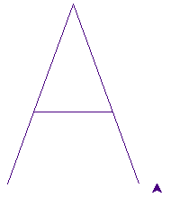

[letter A showcase](./images/letter_A_showcase.png)

##### **Source code: A**

[Click here to inspect the source code of EngLetters.A()](https://github.com/Mangosaber2026/GeometricalUniverse/blob/main/GeometricalDomination/gd/visuals/eng_alphabets/english_letters.py)

Comment Linking: [[#EngLetters-A-anchor|EngLetters_A()]] 

#### **B**
---

##### **Preview: B**

[letter B showcase](./images/letter_B_showcase.png)

##### **Source code: B**

[Click here to inspect the source code of EngLetters.B()](https://github.com/Mangosaber2026/GeometricalUniverse/blob/main/GeometricalDomination/gd/visuals/eng_alphabets/english_letters.py)

Comment Linking: [[#EngLetters-B-anchor|EngLetters_B()]] 

#### **C**
---

##### **Preview: C**

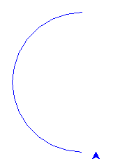

[letter C showcase](./images/letter_C_showcase.png)

##### **Source code: C**

[Click here to inspect the source code of EngLetters.C()](https://github.com/Mangosaber2026/GeometricalUniverse/blob/main/GeometricalDomination/gd/visuals/eng_alphabets/english_letters.py)

Comment Linking: [[#EngLetters-C-anchor|EngLetters_C()]] 

#### **D**
---

##### **Preview: D**

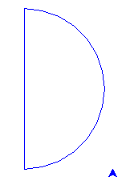

[letter D showcase](./images/letter_D_showcase.png)

##### **Source code: D**

[Click here to inspect the source code of EngLetters.D()](https://github.com/Mangosaber2026/GeometricalUniverse/blob/main/GeometricalDomination/gd/visuals/eng_alphabets/english_letters.py)

Comment Linking: [[#EngLetters-D-anchor|EngLetters_D()]] 

#### **E**
---

##### **Preview: E**

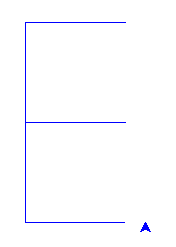

[letter E showcase](./images/letter_E_showcase.png)

##### **Source code: E**

[Click here to inspect the source code of EngLetters.E()](https://github.com/Mangosaber2026/GeometricalUniverse/blob/main/GeometricalDomination/gd/visuals/eng_alphabets/english_letters.py)

Comment Linking: [[#EngLetters-E-anchor|EngLetters_E()]] 

#### **F**
---

##### **Preview: F**

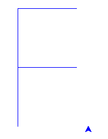

[letter F showcase](./images/letter_F_showcase.png)

##### **Source code: F**

[Click here to inspect the source code of EngLetters.F()](https://github.com/Mangosaber2026/GeometricalUniverse/blob/main/GeometricalDomination/gd/visuals/eng_alphabets/english_letters.py)

Comment Linking: [[#EngLetters-F-anchor|EngLetters_F()]] 

#### **G**
---

##### **Preview: G**

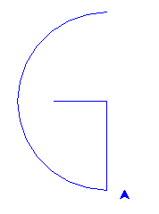

[letter G showcase](./images/letter_G_showcase.png)

##### **Source code: G**

[Click here to inspect the source code of EngLetters.G()](https://github.com/Mangosaber2026/GeometricalUniverse/blob/main/GeometricalDomination/gd/visuals/eng_alphabets/english_letters.py)

Comment Linking: [[#EngLetters-G-anchor|EngLetters_G()]] 

#### **H**
---

##### **Preview: H**

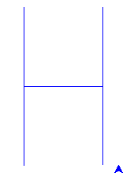

[letter H showcase](./images/letter_H_showcase.png)

##### **Source code: H**

[Click here to inspect the source code of EngLetters.H()](https://github.com/Mangosaber2026/GeometricalUniverse/blob/main/GeometricalDomination/gd/visuals/eng_alphabets/english_letters.py)

Comment Linking: [[#EngLetters-H-anchor|EngLetters_H()]] 

#### **I**
---

##### **Preview: I**

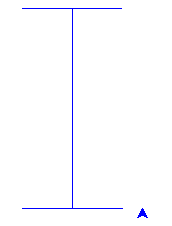

[letter I showcase](./images/letter_I_showcase.png)

##### **Source code: I**

[Click here to inspect the source code of EngLetters.I()](https://github.com/Mangosaber2026/GeometricalUniverse/blob/main/GeometricalDomination/gd/visuals/eng_alphabets/english_letters.py)

Comment Linking: [[#EngLetters-I-anchor|EngLetters_I()]] 

#### **J**
---

##### **Preview: J**

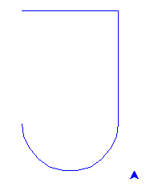

[letter J showcase](./images/letter_J_showcase.png)

##### **Source code: J**

[Click here to inspect the source code of EngLetters.J()](https://github.com/Mangosaber2026/GeometricalUniverse/blob/main/GeometricalDomination/gd/visuals/eng_alphabets/english_letters.py)

Comment Linking: [[#EngLetters-J-anchor|EngLetters_J()]] 

#### **K**
---

##### **Preview: K**

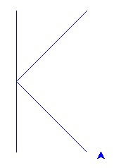

[letter K showcase](./images/letter_K_showcase.png)

##### **Source code: K**

[Click here to inspect the source code of EngLetters.K()](https://github.com/Mangosaber2026/GeometricalUniverse/blob/main/GeometricalDomination/gd/visuals/eng_alphabets/english_letters.py)

Comment Linking: [[#EngLetters-K-anchor|EngLetters_K()]] 

#### **L**
---

##### **Preview: L**

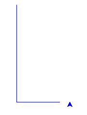

[letter L showcase](./images/letter_L_showcase.png)

##### **Source code: L**

[Click here to inspect the source code of EngLetters.L()](https://github.com/Mangosaber2026/GeometricalUniverse/blob/main/GeometricalDomination/gd/visuals/eng_alphabets/english_letters.py)

Comment Linking: [[#EngLetters-L-anchor|EngLetters_L()]] 

#### **M**
---

##### **Preview: M**

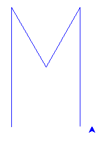

[letter M showcase](./images/letter_M_showcase.png)

##### **Source code: M**

[Click here to inspect the source code of EngLetters.M()](https://github.com/Mangosaber2026/GeometricalUniverse/blob/main/GeometricalDomination/gd/visuals/eng_alphabets/english_letters.py)

Comment Linking: [[#EngLetters-M-anchor|EngLetters_M()]] 

#### **N**
---

##### **Preview: N**

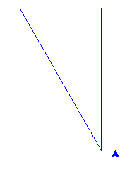

[letter N showcase](./images/letter_N_showcase.png)

##### **Source code: N**

[Click here to inspect the source code of EngLetters.N()](https://github.com/Mangosaber2026/GeometricalUniverse/blob/main/GeometricalDomination/gd/visuals/eng_alphabets/english_letters.py)

Comment Linking: [[#EngLetters-N-anchor|EngLetters_N()]] 

#### **O**
---

##### **Preview: O**

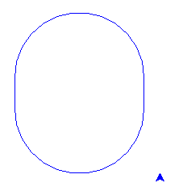

[letter O showcase](./images/letter_O_showcase.png)

##### **Source code: O**

[Click here to inspect the source code of EngLetters.O()](https://github.com/Mangosaber2026/GeometricalUniverse/blob/main/GeometricalDomination/gd/visuals/eng_alphabets/english_letters.py)

Comment Linking: [[#EngLetters-O-anchor|EngLetters_O()]] 

#### **P**
---

##### **Preview: P**

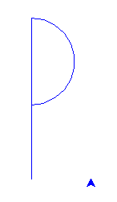

[letter P showcase](./images/letter_P_showcase.png)

##### **Source code: P**

[Click here to inspect the source code of EngLetters.P()](https://github.com/Mangosaber2026/GeometricalUniverse/blob/main/GeometricalDomination/gd/visuals/eng_alphabets/english_letters.py)

Comment Linking: [[#EngLetters-P-anchor|EngLetters_P()]] 

#### **Q**
---

##### **Preview: Q**

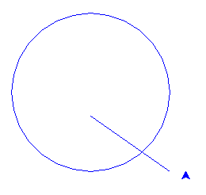

[letter Q showcase](./images/letter_Q_showcase.png)

##### **Source code: Q**

[Click here to inspect the source code of EngLetters.Q()](https://github.com/Mangosaber2026/GeometricalUniverse/blob/main/GeometricalDomination/gd/visuals/eng_alphabets/english_letters.py)

Comment Linking: [[#EngLetters-Q-anchor|EngLetters_Q()]] 

#### **R**
---

##### **Preview: R**

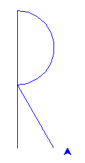

[letter R showcase](./images/letter_R_showcase.png)

##### **Source code: R**

[Click here to inspect the source code of EngLetters.R()](https://github.com/Mangosaber2026/GeometricalUniverse/blob/main/GeometricalDomination/gd/visuals/eng_alphabets/english_letters.py)

Comment Linking: [[#EngLetters-R-anchor|EngLetters_R()]] 

#### **S**
---

##### **Preview: S**

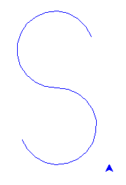

[letter S showcase](./images/letter_S_showcase.png)

##### **Source code: S**

[Click here to inspect the source code of EngLetters.S()](https://github.com/Mangosaber2026/GeometricalUniverse/blob/main/GeometricalDomination/gd/visuals/eng_alphabets/english_letters.py)

Comment Linking: [[#EngLetters-S-anchor|EngLetters_S()]] 

#### **T**
---

##### **Preview: T**

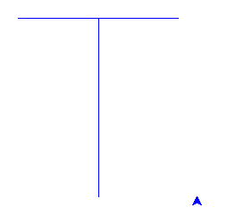

[letter T showcase](./images/letter_T_showcase.png)

##### **Source code: T**

[Click here to inspect the source code of EngLetters.T()](https://github.com/Mangosaber2026/GeometricalUniverse/blob/main/GeometricalDomination/gd/visuals/eng_alphabets/english_letters.py)

Comment Linking: [[#EngLetters-T-anchor|EngLetters_T()]] 

#### **U**
---

##### **Preview: U**

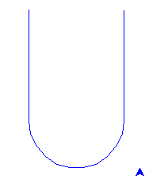

[letter U showcase](./images/letter_U_showcase.png)

##### **Source code: U**

[Click here to inspect the source code of EngLetters.U()](https://github.com/Mangosaber2026/GeometricalUniverse/blob/main/GeometricalDomination/gd/visuals/eng_alphabets/english_letters.py)

Comment Linking: [[#EngLetters-U-anchor|EngLetters_U()]] 

#### **V**
---

##### **Preview: V**

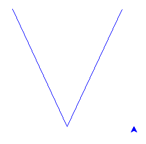

[letter V showcase](./images/letter_V_showcase.png)

##### **Source code: V**

[Click here to inspect the source code of EngLetters.V()](https://github.com/Mangosaber2026/GeometricalUniverse/blob/main/GeometricalDomination/gd/visuals/eng_alphabets/english_letters.py)

Comment Linking: [[#EngLetters-V-anchor|EngLetters_V()]] 

#### **W**
---

##### **Preview: W**

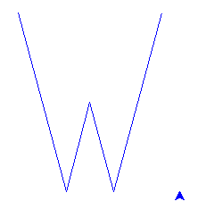

[letter W showcase](./images/letter_W_showcase.png)

##### **Source code: W**

[Click here to inspect the source code of EngLetters.W()](https://github.com/Mangosaber2026/GeometricalUniverse/blob/main/GeometricalDomination/gd/visuals/eng_alphabets/english_letters.py)

Comment Linking: [[#EngLetters-W-anchor|EngLetters_W()]] 

#### **X**
---

##### **Preview: X**

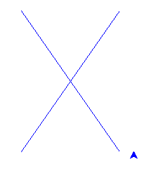

[letter X showcase](./images/letter_X_showcase.png)

##### **Source code: X**

[Click here to inspect the source code of EngLetters.X()](https://github.com/Mangosaber2026/GeometricalUniverse/blob/main/GeometricalDomination/gd/visuals/eng_alphabets/english_letters.py)

Comment Linking: [[#EngLetters-X-anchor|EngLetters_X()]] 

#### **Y**
---

##### **Preview: Y**

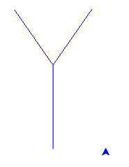

[letter Y showcase](./images/letter_Y_showcase.png)

##### **Source code: Y**

[Click here to inspect the source code of EngLetters.Y()](https://github.com/Mangosaber2026/GeometricalUniverse/blob/main/GeometricalDomination/gd/visuals/eng_alphabets/english_letters.py)

Comment Linking: [[#EngLetters-Y-anchor|EngLetters_Y()]] 

#### **Z**
---

##### **Preview: Z**

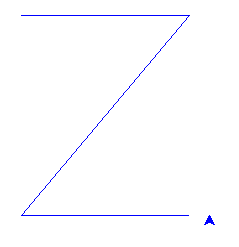

[letter Z showcase](./images/letter_Z_showcase.png)

##### **Source code: Z**

[Click here to inspect the source code of EngLetters.Z()](https://github.com/Mangosaber2026/GeometricalUniverse/blob/main/GeometricalDomination/gd/visuals/eng_alphabets/english_letters.py)

Comment Linking: [[#EngLetters-Z-anchor|EngLetters_Z()]] 

#### **Source code: EngLetters**

[Click here to inspect the source code of `EngLetters`](https://github.com/Mangosaber2026/GeometricalUniverse/blob/main/GeometricalDomination/gd/visuals/eng_alphabets/english_letters.py)

Comment Linking: [[#EngLetters-anchor|class EngLetters]] 

## Source code: English Letters

[View source code](https://github.com/Mangosaber2026/GeometricalUniverse/blob/main/GeometricalDomination/gd/visuals/eng_alphabets/english_letters.py)